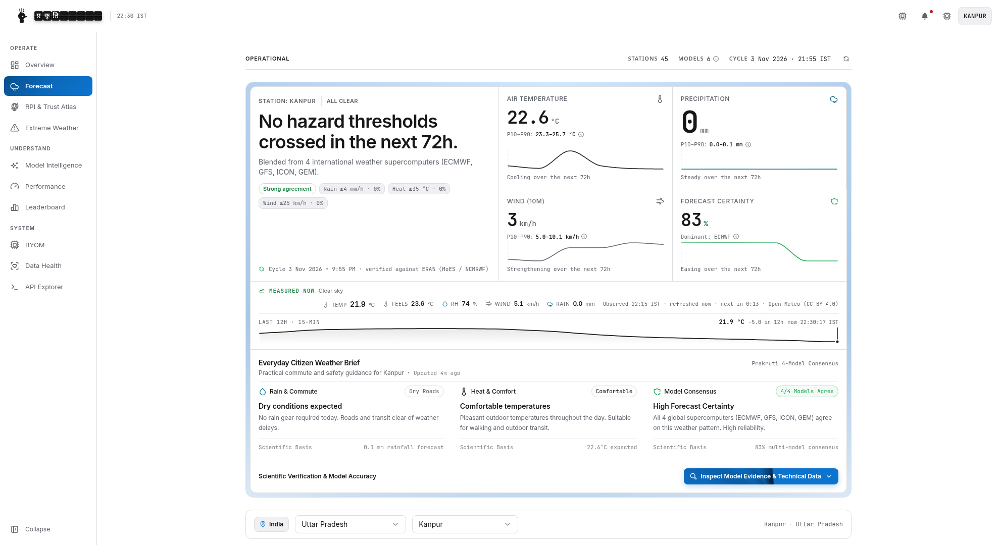
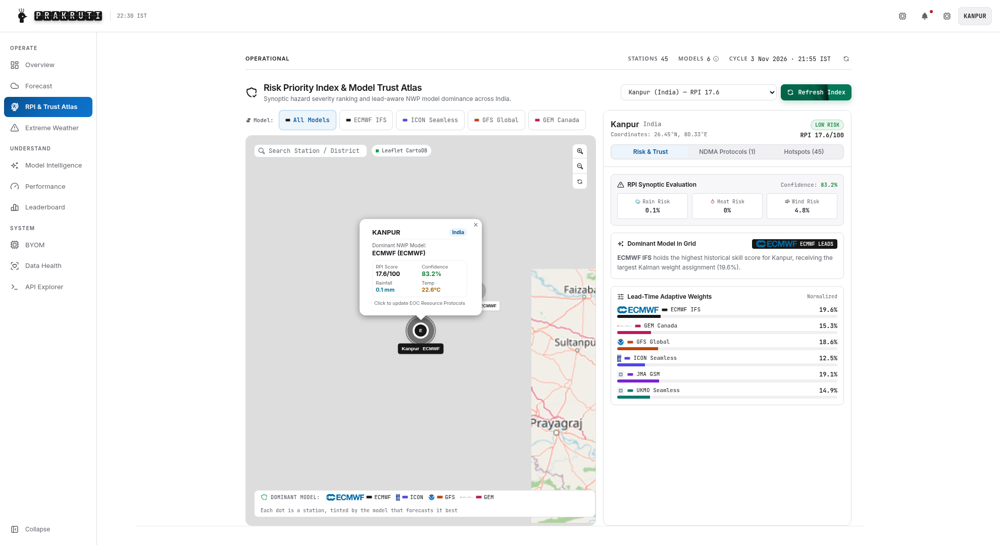
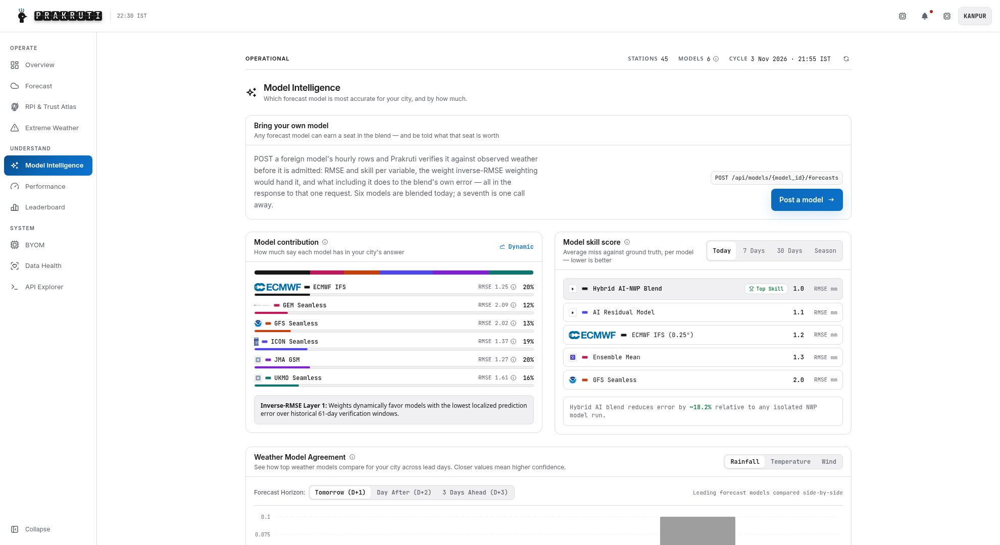
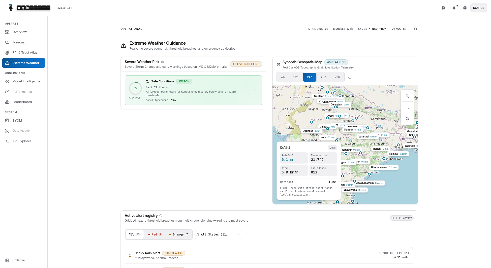
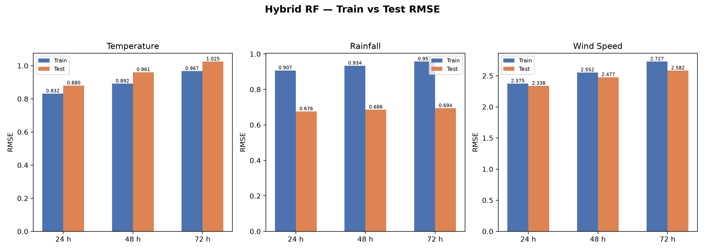
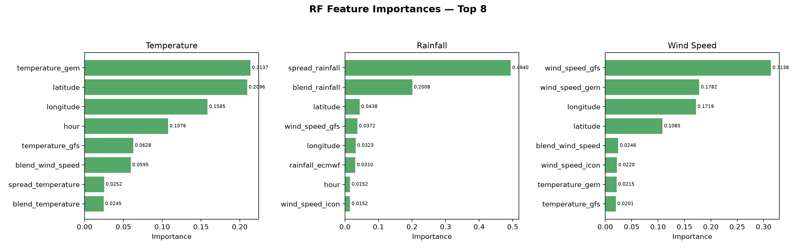

# Prakruti · प्रकृति

**Blends ECMWF, GFS, ICON & GEM into one forecast with a 0–100% confidence score — for 45 Indian cities, 72 hours ahead.**

[](LICENSE)
[](https://prakruti-ten.vercel.app)
[](https://github.com/imstillashish/Prakruti/actions/workflows/ci.yml)
[](https://sih.gov.in/)
[-green.svg)](https://moes.gov.in/)


> **[→ Try the live demo](https://prakruti-ten.vercel.app)**

---

## What it does

India gets four global weather forecasts — ECMWF, GFS, ICON, GEM — that often disagree by 5–10 °C or 20+ mm of rain for the same city and hour. Prakruti verifies each model against ERA5 ground truth over 61 days, blends them with inverse-RMSE weights, then shows a single 0–100% confidence number that tells you how much to trust the result.

| You ask | Prakruti answers |
| :--- | :--- |
| *Will it rain this evening?* | Hourly rainfall, temperature and wind for the next 72 hours |
| *Is it safe to plan outdoor work?* | Early warnings for heatwaves, heavy rain and high winds |
| *How bad could it get?* | A 0–100 Risk Priority Index with readiness levels for disaster agencies |
| *Which forecast should I trust today?* | A per-city accuracy score for each of the 4 models |

---

## Install

```bash
git clone https://github.com/imstillashish/Prakruti.git
cd Prakruti
make dev
```

That's it. `make dev` installs both services and starts them — API on `:5000`, dashboard on `:3000`.

> **Requires:** Python 3.10+ and Node 18+

---

## How it works

```
4 model forecasts          Accuracy checker        Smart blend
ECMWF · GFS · ICON · GEM  vs. ERA5 actuals    →   weighted by past RMSE
                                ↓
                       Your city's weather
                       + confidence 0–100%
                       + plain-language advice
                       + disaster alerts
```

### AI pipeline (`python ai/pipeline.py`)

| Stage | What it does |
| :--- | :--- |
| `skill_lead.py` | Verifies each model against ERA5 per city, variable and lead day (D+1/2/3) |
| `weights_lead.py` | Converts errors into lead-adaptive weights: w ∝ 1/RMSE² |
| `blend_lead.py` / `blend_current.py` | Weighted consensus forecast |
| `train.py` | Random Forest regressors remove residual terrain and diurnal biases |
| `confidence_engine.py` | 0–100% = 50% skill + 30% inter-model agreement + 20% lead decay |
| `alerts.py` | Heatwave, cloudburst and windstorm thresholds → hazard alerts |

---

## Screenshots

<p>
  
  
</p>
<p>
  
  
</p>

---

## Tech stack

| Layer | Tools |
| :--- | :--- |
| Frontend | Next.js 15, React 19, TypeScript 5, Tailwind CSS v4, Leaflet, Recharts |
| Backend | Python 3.10+, Flask 3, SQLite |
| AI / ML | scikit-learn Random Forests, NumPy/pandas, inverse-RMSE weighting |

---

## API

The Flask API is live at **https://prakruti-api.onrender.com** (free tier — wakes in ~15 s if cold).

Key endpoints: `/api/forecast`, `/api/confidence`, `/api/weights`, `/api/skill`, `/api/alerts`, `/api/rpi`, `/api/cities`, `/api/metadata`

---

## Datasets

| File | Source | Rows |
| :--- | :--- | ---: |
| `data/forecast_history.csv` | Historical Forecast API (61 days, 4 models) | 263,520 |
| `data/actual_history.csv` | ERA5 reanalysis ground truth | 65,880 |
| `data/forecast_current.csv` | Rolling 72-hour live window | 12,960 |

All timestamps: Asia/Kolkata (IST). Run `python api/validate_data.py` for the 12-point integrity check.

---

## Model performance

<p>
  
  
</p>

---

## Contributing

See [CONTRIBUTING.md](CONTRIBUTING.md). Good first issues are labelled [`good first issue`](https://github.com/imstillashish/Prakruti/labels/good%20first%20issue). We respond within a day.

---

## Deployment

- Dashboard: **https://prakruti-ten.vercel.app** (Vercel, auto-deploys from `main`)
- API: **https://prakruti-api.onrender.com** (Render, free tier)

Full deployment notes in [docs/DEPLOYMENT.md](docs/DEPLOYMENT.md).

---

## Team EXELION

| # | Name | Role |
|---|------|------|
| 1 | Palak Srivastava | Team Lead |
| 2 | Prachi Jha | Member |
| 3 | Mahima Shukla | Member |
| 4 | Om Vishwakarma | Member |
| 5 | Patel Ashish Suresh | Member |
| 6 | Param Gupta | Member |

Built for Smart India Hackathon 2026 — PS-26081, Ministry of Earth Sciences (NCMRWF).

---

## Acknowledgments

Weather data from [Open-Meteo](https://open-meteo.com) (ECMWF IFS, NOAA GFS, DWD ICON, CMC GEM) and ERA5 via the Copernicus Climate Change Service.

Hand-drawn animated icons vendored from [ItsHover](https://itshover.com) (Apache-2.0). Split-flap board from [React Bits](https://reactbits.dev).

Model marks (`frontend/public/brands/`) are the owners' published files shown for identification only — © ECMWF, © Deutscher Wetterdienst, NOAA (PD-USGov), ECCC (PD Canada). No affiliation or endorsement implied.

---

## License

[MIT](LICENSE) © 2026 Team EXELION
